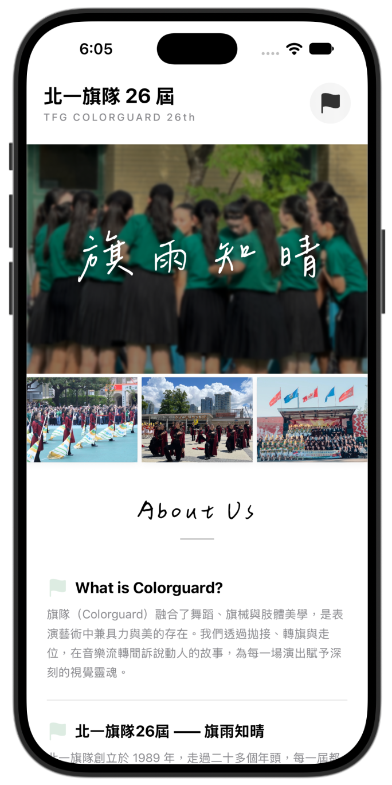
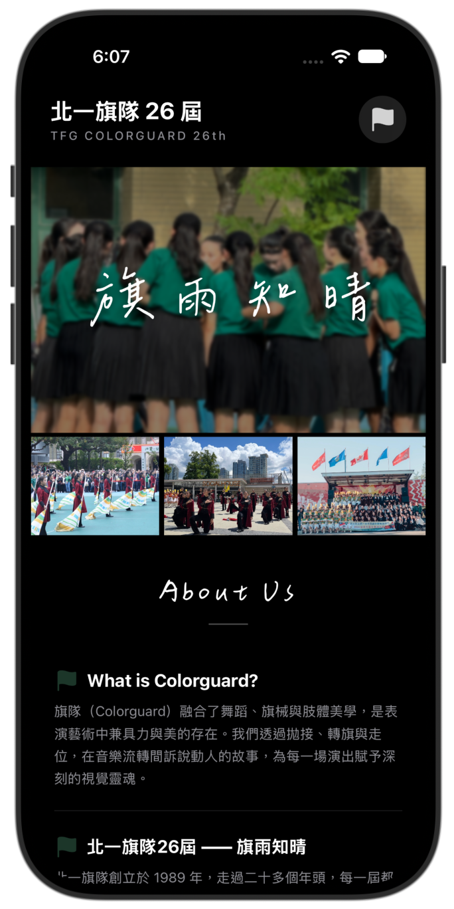
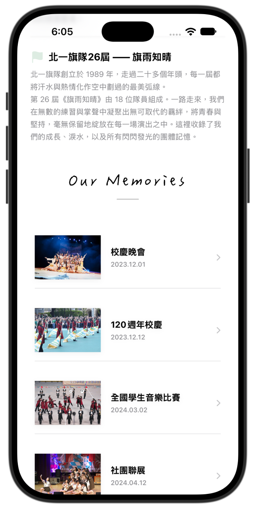
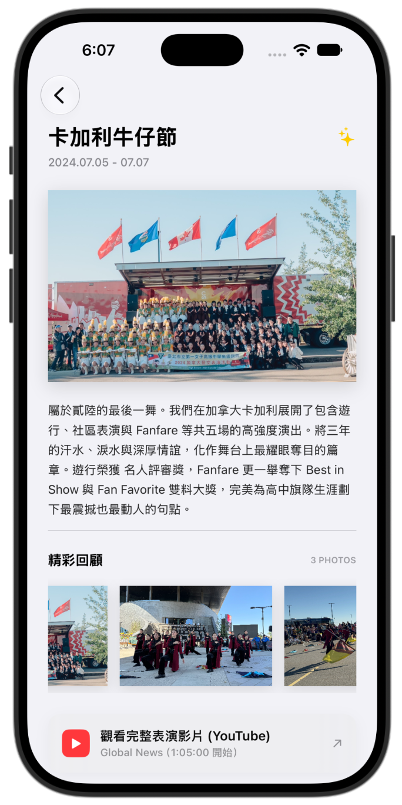
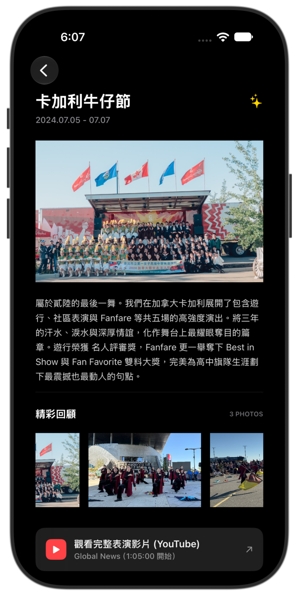
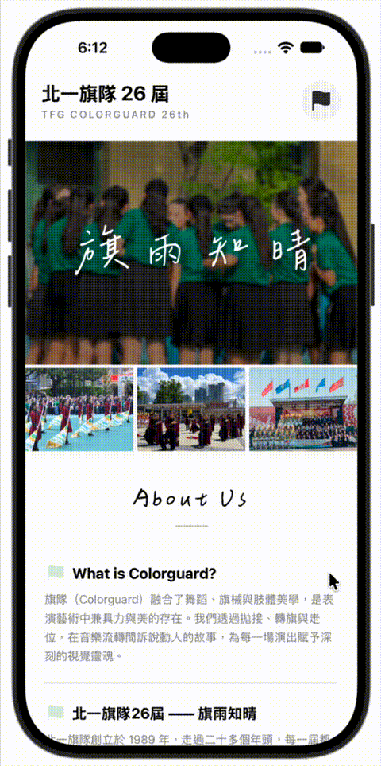

<div align="center">

# 🚩 北一旗隊 26 屆 ――「旗雨知晴」
### TFG Colorguard 26th — About Page iOS App

<p align="center">
  <a href="#english"><b>English</b></a> • <a href="#繁體中文"><b>繁體中文</b></a>
</p>

[](https://swift.org)
[](https://developer.apple.com/xcode/swiftui/)
[](https://developer.apple.com/xcode/)
[](https://developer.apple.com/ios/)
[](https://developer.apple.com/design/human-interface-guidelines/dark-mode)
[](https://github.com/Chenyu-otf/chenyuluoyan_thin)

*「每一屆都將汗水與熱情化作空中劃過的最美弧線。」*  
*A tribute to the youth, dedication, and dazzling performances of Taipei First Girls' High School Colorguard (26th).*

</div>

---

<a id="english"></a>
## 📖 English

<p align="right">
  <a href="#繁體中文">🌐 Switch to Traditional Chinese (切換至繁體中文)</a>
</p>

### 📌 Overview

**TFG Colorguard 26th ("旗雨知晴")** is a native iOS application built with **SwiftUI**. Crafted as an expressive commemorative "About Page," the app chronicles the monumental journey, brotherhood, and milestones of the 26th cadre of the Taipei First Girls' High School Colorguard.

From local school anniversary performances to international stages at the **Calgary Stampede** in Canada, this app preserves unforgettable memories with elegant typography, rich photography, interactive navigation, and full **Light & Dark Mode** support.

---

### 📸 Visual Showcase & Demo

#### 1. Home Cover (封面：淺色 / 深色)
> The hero section showcases the team motto *"旗雨知晴"* in handcrafted calligraphy over a frosted background image, paired with a curated 3-photo highlight strip.

| ☀️ Light Mode (封面白) | 🌙 Dark Mode (封面黑) |
| :---: | :---: |
|  |  |

<br/>

#### 2. Main Screen — Scrolling Down (主畫面往下瀏覽)
> Seamless vertical flow guiding readers through the core philosophy of Colorguard, team heritage, and the chronological *Our Memories* timeline.

| 📜 Content & Memories Timeline (主畫面往下) |
| :---: |
|  |

<br/>

#### 3. Performance Detail View (裡面：詳細演出頁面)
> In-depth recap of each performance featuring a high-resolution hero stage shot, historical narrative, horizontal scrollable photo gallery, and direct YouTube performance links.

| ☀️ Light Mode Detail (裡面卡加利 - 淺色) | 🌙 Dark Mode Detail (裡面黑 - 深色) |
| :---: | :---: |
|  |  |

<br/>

#### 4. Interactive Demo (操作展示)
> Fluid transitions powered by `NavigationStack`, responsive gestures, and external YouTube handoffs.

<div align="center">
  
</div>

---

### ✨ Key Features

- 🌸 **Artistic Typography**: Integrated custom Chinese calligraphy font **ChenYuluoyan (辰宇落雁體)** for section headings and hero titles.
- 🌓 **Adaptive Dark & Light Theme**: Built-in dynamic color palette (`DynamicBackground`, `.ultraThinMaterial`, and semantic system colors) ensuring flawless aesthetics in any lighting condition.
- 🖼️ **Interactive Multi-Photo Gallery**:
  - Top 3-photo highlight strip with subtle card borders and shadows.
  - Horizontal floating photo carousel (`ScrollView(.horizontal)`) on detail pages for browsing candid moments.
- 🏆 **Chronological Performance Timeline**:
  - 🎭 **School Anniversary Gala** (*Anthea*)
  - 🤝 **120th Anniversary** (Joint performance with Japan's Tachibana High School)
  - 🥇 **National Student Music Competition** (*Special Distinction Award*)
  - 🎨 **Club Exhibition** (*Antiquary*)
  - 🥈 **Grand Prix** (*Silver Award* with *Lady Burglar*)
  - 🍁 **Taiwan-Canada Arts & Culture Festival** (First international performance)
  - 🤠 **Calgary Stampede** (*Parade Celebrity Judges Award*, *Fanfare Best in Show* & *Fan Favorite*)
- 🔗 **Deep Video Integration**: Seamlessly opens full-length official recordings via external YouTube links using SwiftUI's `@Environment(\.openURL)`.

---

### 🛠️ Tech Stack & Architecture

- **Language**: Swift 5.9+
- **UI Framework**: SwiftUI (iOS 17+)
- **Navigation**: `NavigationStack` with type-safe routing
- **Layout & Effects**: `GeometryReader`, `ZStack`, `LinearGradient`, `.ultraThinMaterial`, `ScrollView`
- **Typography**: Custom OTF/TTF font registration (`ChenYuluoyan-Thin-Monospaced.ttf`) in `Info.plist`

```
#3-aboutpage/
├── #3-aboutpage/
│   ├── MyApp.swift                      # App Entry Point
│   ├── ContentView.swift                # Root View, Hero Cover & Memories List
│   ├── performanceItem.swift            # Identifiable Performance Data Model
│   ├── performanceRowView.swift         # Reusable Timeline Row Component
│   ├── performanceDetialView.swift      # Performance Detail View & Carousel
│   ├── ChenYuluoyan-Thin-Monospaced.ttf # Custom Calligraphy Font
│   └── Assets.xcassets/                 # Image Sets & Dynamic Color Tokens
├── screenshots/                         # Screenshots & Demo GIF
└── README.md                            # Documentation
```

---

### 🚀 Getting Started

1. **Clone the repository**:
   ```bash
   git clone https://github.com/olivia20-rt/-3-aboutpage.git
   cd -3-aboutpage
   ```
2. **Open with Xcode**:
   ```bash
   open "#3-aboutpage.xcodeproj"
   ```
3. **Run on Simulator or Device**:
   - Select any iOS Simulator running **iOS 17.0** or later (e.g., iPhone 15 / 16).
   - Press <kbd>Cmd</kbd> + <kbd>R</kbd> to build and run.

---

<br/>
<br/>

---

<a id="繁體中文"></a>
## 🇹🇼 繁體中文

<p align="right">
  <a href="#english">🌐 切換至英文版 (Switch to English)</a>
</p>

### 📌 專案簡介

**北一旗隊 26 屆 ――「旗雨知晴」** 是一款以 **SwiftUI** 原生打造的個人化介紹頁面（About Page）iOS 應用程式。

本專案記錄了臺北市立第一女子高級中學樂儀旗隊――旗隊第 26 屆隊員們揮灑青春、苦練汗水與收穫榮耀的點滴歷程。從校園舞台、全國學生音樂比賽特優，一路邁向加拿大**卡加利牛仔節 (Calgary Stampede)** 榮獲雙料大獎的國際舞台。透過典雅的排版、字型美學與多媒體互動，將珍貴的回憶永久珍藏。

---

### 📸 畫面預覽與操作展示

#### 1. 封面頁面（淺色模式 / 深色模式）
> 上方大圖以半透明深色漸層遮罩搭配**「辰宇落雁體」**手寫書法字體《旗雨知晴》，底下緊接 3 張精選相片卡片，營造兼具溫暖與儀式感的視覺風格。

| ☀️ 封面白（淺色模式） | 🌙 封面黑（深色模式） |
| :---: | :---: |
|  |  |

<br/>

#### 2. 主畫面往下瀏覽（團隊介紹與回顧列表）
> 往下捲動瀏覽「What is Colorguard?」與「北一旗隊26屆 ―― 旗雨知晴」的文字精神，並以優雅的長條卡片呈現 7 場重大演出的時序清單。

| 📜 主畫面往下（內容與歷年回顧列表） |
| :---: |
|  |

<br/>

#### 3. 演出詳情頁面（裡面：詳細演出頁面）
> 點擊任一場演出進入詳情頁，包含大尺寸主視覺劇照、深情敘事、可左右滑動的相簿花絮，以及可直接開啟 YouTube 觀看演出的按鈕。

| ☀️ 裡面白（卡加利牛仔節 - 淺色模式） | 🌙 裡面黑（深色模式） |
| :---: | :---: |
|  |  |

<br/>

#### 4. 實際操作動態展示（Demo GIF）
> 完整示範上下滑動捲動視圖、點擊卡片跳轉至詳情頁、橫向瀏覽精彩回顧照片以及點擊 YouTube 按鈕的流暢體驗。

<div align="center">
  
</div>

---

### ✨ 核心特色亮點

- 🌸 **客製手寫字型整合**：在 `Info.plist` 中載入並註冊**「辰宇落雁體 (ChenYuluoyan Thin Monospaced)」**，展現細緻的手寫文藝氣質。
- 🌓 **雙色模式完美自適應**：全頁面元素支援 Dark / Light Mode，運用自訂顏色資產 `DynamicBackground`、毛玻璃材質 `.ultraThinMaterial` 以及系統動態語意色彩。
- 🎞️ **多層次照片畫廊體驗**：
  - 首頁 3 張等寬照片橫幅，搭配細緻邊框與陰影。
  - 詳情頁橫向捲動相簿 (`ScrollView(.horizontal)`)，可瀏覽多張高畫質演出與幕後花絮照片。
- 🏆 **完整收錄 7 大代表演出歷程**：
  - 🎭 **校慶晚會 (2023.12.01)**：主題《Anthea》，結合旗、槍、飄扇的優雅姿態。
  - 🤝 **120 週年校慶 (2023.12.12)**：與日本橘高校同臺交流，留下珍貴國際友誼。
  - 🥇 **全國學生音樂比賽 (2024.03.02)**：無數烈日下的雕琢，榮獲評審一致肯定奪得「特優」。
  - 🎨 **社團聯展 (2024.04.12)**：主題《Antiquary》，交織復古視覺饗宴。
  - 🥈 **大獎賽 (2024.04.28)**：以《Lady burglar》神秘戲劇張力奪得「銀獎」。
  - 🍁 **台加藝文節 (2024.07.02)**：貳陸第一場國外演出，將台灣熱血帶上國際舞台。
  - 🤠 **卡加利牛仔節 (2024.07.05 - 07.07)**：五場高強度演出，勇奪名人評審獎、Best in Show 與 Fan Favorite 雙料大獎，劃下最動人句點。
- 🎬 **外部影音連結串接**：透過 SwiftUI 原生 `@Environment(\.openURL)`，點擊 YouTube 按鈕即可直達精彩演出影片。

---

### 🛠️ 技術架構與模組設計

- **語言與架構**：Swift 5.9+ / SwiftUI
- **支援版本**：iOS 17.0+
- **頁面導覽**：`NavigationStack` + `NavigationLink`
- **佈局元件**：`ScrollView`, `GeometryReader`, `HStack`, `VStack`, `ZStack`
- **視覺效果**：動態毛玻璃 (`.ultraThinMaterial`)、線性漸層 (`LinearGradient`)、投影 (`shadow`)
- **檔案組織**：
  - `ContentView.swift`：主畫面、大封面標頭元件 (`CoverHeaderView`)、介紹文字與演出列表
  - `performanceItem.swift`：演出資料模型 (`PerformanceItem: Identifiable`)
  - `performanceRowView.swift`：條列式演出卡片視圖 (`PerformanceRowView`)
  - `performanceDetialView.swift`：演出詳細內容頁面 (`PerformanceDetailView`)

---

### 🚀 如何在 Xcode 運行

1. **複製專案至本地**：
   ```bash
   git clone https://github.com/olivia20-rt/-3-aboutpage.git
   cd -3-aboutpage
   ```
2. **使用 Xcode 開啟**：
   ```bash
   open "#3-aboutpage.xcodeproj"
   ```
3. **編譯並執行**：
   - 選擇 iOS 17.0+ 模擬器（例如 iPhone 15 / iPhone 16）。
   - 按下快速鍵 <kbd>Cmd</kbd> + <kbd>R</kbd> 即可在模擬器上體驗。

---

### 💌 關於北一旗隊 26 屆

> 北一旗隊創立於 1989 年，走過二十多個年頭，每一屆都將汗水與熱情化作空中劃過的最美弧線。  
> 第 26 屆《旗雨知晴》由 18 位隊員組成。一路走來，我們在無數的練習與掌聲中凝聚出無可取代的羈絆，將青春與堅持，毫無保留地綻放在每一場演出之中。

<div align="center">
  <p><b>Official Instagram:</b> <a href="https://instagram.com/tfgcolorguard">@tfgcolorguard</a></p>
  <p>Made with ❤️ and dedication.</p>
</div>
